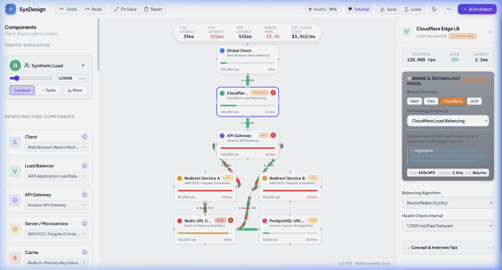
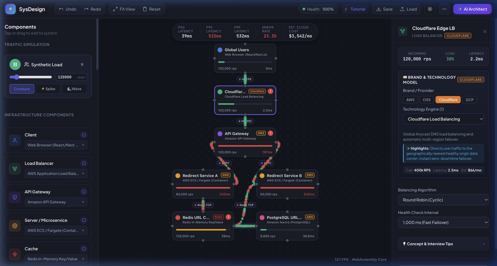
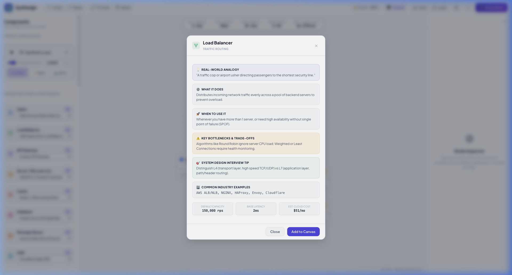

<div align="center">

# ⚡ SysDesign AI Simulator
### Interactive 60–120 FPS WebAssembly System Design Simulator & Interview Trainer

[](https://webassembly.org/)
[](https://www.rust-lang.org/)
[](https://developer.mozilla.org/en-US/docs/Web/API/Canvas_API)
[](https://vitejs.dev/)
[](LICENSE)
[](https://github.com/anuragarwalkar/system-design-ai-simulator/pulls)

<p align="center">
  <strong>Design, simulate, stress-test, and master distributed systems with real-time packet physics, queueing theory, and AI architectural feedback.</strong>
</p>

<p align="center">
  <a href="#-key-features">Key Features</a> •
  <a href="#-visual-walkthrough">Screenshots</a> •
  <a href="#-interview-scenarios">Interview Scenarios</a> •
  <a href="#-architecture--patterns">Architecture</a> •
  <a href="#-quickstart">Quickstart</a> •
  <a href="#-tech-stack">Tech Stack</a>
</p>

---



</div>

---

## 💡 Why SysDesign AI Simulator?

Most system design tools (like draw.io, Miro, or Excalidraw) are **static whiteboards**—they show boxes and arrows, but cannot tell you what happens when **150,000 requests/sec** hit your API Gateway, when your Redis cache experiences a **92% hit ratio vs 40%**, or when a server crashes causing a cascading failure.

**SysDesign AI Simulator** bridges the gap between drawing diagrams and running real distributed systems:
- It **animates live synthetic traffic** along cubic Bezier network paths at **60–120 FPS**.
- It uses **queueing theory (M/M/1 & M/M/c)** and **WebAssembly (WASM)** to compute dynamic node utilization, queue depths, and realistic latency percentiles (`p50`, `p95`, `p99`).
- It models **real cloud technologies** (AWS ALB, Cloudflare Magic Transit, NGINX, Redis, Kafka, Postgres, DynamoDB).
- It features an autonomous **LangChain AI System Architect** that evaluates bottlenecks, runs Tarjan's bridge-finding algorithm to highlight Single Points of Failure (SPOFs), and automatically optimizes your architecture.

---

## 🌟 Key Features

### ⚡ 1. 60–120 FPS WebAssembly Simulation Core
- **Zero-Allocation Object Pool**: High-performance particle engine renders tens of thousands of animated request packets along cubic Bezier splines without GC stutter.
- **Mathematical Queueing Models**: Accurate M/M/1 and M/M/c queueing curves dynamically calculate service times, backlog delays, and overload dropping.
- **Realistic Percentile Latency**: Calculates live `p50`, `p95`, and `p99` response times based on backend server load, network hops, and cache miss penalties.
- **Rust Engine + In-Browser Fallback**: Includes a standalone Rust crate compiled to WASM (`wasm-engine/`) plus an embedded WebAssembly coprocessor ensuring instantaneous out-of-the-box execution in any browser.

### ☁️ 2. Real Cloud Providers & Infrastructure Engines
Configure nodes using real industry engines with tailored performance baselines, hourly cost estimates, and latency profiles:
- **Load Balancers**: AWS Application Load Balancer (ALB), AWS Network Load Balancer (NLB), Cloudflare Magic Transit, NGINX, HAProxy, Envoy, GCP Cloud LB.
- **API Gateways**: Amazon API Gateway, Kong Enterprise, Envoy / Ambassador, Apigee.
- **Compute / Microservices**: AWS ECS / Fargate, Kubernetes Pods (EKS/GKE), AWS Lambda, Node.js Fastify, Go Gin, Java Spring Boot.
- **In-Memory Caches**: Redis, Memcached, Dragonfly In-Memory, AWS ElastiCache.
- **Databases**: PostgreSQL, MySQL (InnoDB Cluster), MongoDB, AWS DynamoDB, Apache Cassandra.
- **Event Streaming**: Apache Kafka, RabbitMQ, AWS SQS Distributed Queue, Redis Streams.
- **Edge CDNs**: Cloudflare Enterprise CDN, Amazon CloudFront, Fastly Real-Time CDN.

### 🤖 3. Autonomous LangChain AI Architect
- **Natural Language Design**: Prompt the AI with commands like:
  - *"Design a high-scale URL Shortener like Bitly with a 100:1 read-to-write ratio"*
  - *"Add a Redis cache layer and eliminate all single points of failure"*
  - *"Stress-test this system with 250,000 requests/sec and evaluate bottlenecks"*
- **Tarjan's Articulation Points Algorithm**: Mathematically isolates critical bridge nodes where a failure would partition downstream services.
- **1-Click Auto-Fix**: Automatically provisions read replicas, adds load-balanced microservice instances, or configures cache-aside patterns directly from recommendations.
- **BYOK (Bring Your Own Key)**: Connect your OpenAI / Anthropic API keys or local LLMs (Ollama, LM Studio) directly in the settings panel.

### 📚 4. System Design Interview Trainer (10 Scenarios)
Pre-configured, production-grade distributed architectures sorted from beginner to expert difficulty:

| # | Scenario | Difficulty | Target RPS | Key Concepts Tested |
|---|----------|------------|------------|---------------------|
| 1 | **URL Shortener (Bitly)** | Easy | 120,000 | Base62 encoding, Read-heavy Cache-Aside, 301 vs 302 redirects |
| 2 | **Pastebin / Text Storage** | Easy | 60,000 | S3 Object Storage, TTL expiration, CloudFront CDN edge caching |
| 3 | **Distributed Rate Limiter** | Medium | 200,000 | Sliding Window Counter, Token Bucket, Redis atomic counters |
| 4 | **WhatsApp / Slack Chat** | Medium | 80,000 | WebSocket connection gateways, Pub/Sub fanout, message persistence |
| 5 | **Push Notification System** | Medium | 150,000 | Distributed task queues (Kafka/SQS), exponential backoff, rate pacing |
| 6 | **Social Timeline / Newsfeed** | Hard | 300,000 | Fanout-on-write vs Fanout-on-read, Celebrity problem, Redis feed cache |
| 7 | **Video Streaming (Netflix)** | Hard | 250,000 | Multi-region CDN, HLS/DASH chunking, Transcoding queue workers |
| 8 | **Distributed Cache Cluster** | Hard | 500,000 | Consistent Hashing, Virtual nodes, replication, eviction policies |
| 9 | **Web Crawler & Search** | Expert | 100,000 | Frontier queue, robots.txt politeness, duplicate detection, inverted index |
| 10 | **Ride-Sharing Dispatch (Uber)** | Expert | 180,000 | Geospatial indexing (H3 / S2 cells), real-time driver tracking, match engine |

### 💡 5. Interactive Concept Explainer
Every component features a dedicated **Concept & Architecture Guide** with:
- **Real-World Analogies**: *"A load balancer is like an airport security usher directing travelers to the shortest line."*
- **What It Does & When to Use It**: Comprehensive architectural rationale.
- **Key Trade-Offs**: Throughput vs consistency, caching pitfalls, partition tolerance.
- **Top Interview Tips**: Practical advice tailored for senior and staff engineering interviews.

---

## 📸 Visual Walkthrough

### 🌓 Cyber Indigo Dark Mode
*Ultra-sleek Obsidian dark theme with glowing neon data flows, live node health indicators, and real-time load bars.*



---

### 📖 Concept Explainer & Interview Guide
*Interactive architectural modals providing real-world analogies, failure modes, and interview tips for every component.*



---

## 🏗️ Architecture & Patterns

The codebase is built cleanly in Vanilla JavaScript and WebAssembly with zero bulky frontend framework overhead, ensuring instantaneous loading and maximum canvas framerates:

```
src/
├── ai/                     # LangChain agent, scenario definitions, tool definitions
├── canvas/                 # 60FPS canvas engine: camera, nodes, edges, particle pool
├── components/             # UI modules: sidebar palette, config inspector, metrics HUD
├── core/                   # State manager, history (Undo/Redo), WebAssembly bridge, event bus
├── interaction/            # Touch gestures, drag-and-drop, wiring connections, shortcuts
├── styles/                 # Design system tokens, light/dark themes, responsive layouts
└── wasm-engine/            # High-performance Rust WebAssembly simulation crate
```

### Key Design Patterns Implemented:
- **Observer Pattern (`event-bus.js`)**: Completely decouples simulation computations, canvas rendering, and HTML inspector panels.
- **Strategy Pattern (`wasm-engine/`)**: Swappable load balancing policies (Round Robin, Least Connections, Consistent Hashing) and cache eviction strategies (LRU, LFU, FIFO).
- **Command Pattern (`history-manager.js`)**: Full reversible history stack supporting standard `Cmd+Z` (Undo) and `Cmd+Y` (Redo).
- **Object Pool Pattern (`particle-system.js`)**: Eliminates V8 garbage collection pauses by reusing pre-allocated packet instances.
- **Adapter Pattern (`wasm-bridge.js`)**: Seamless bidirectional data exchange between JavaScript typed arrays and WebAssembly linear memory.

---

## 🚀 Quickstart

### Prerequisites
- [Node.js](https://nodejs.org/) (v18 or higher)
- npm or yarn

### 1. Clone & Run
```bash
# Clone the repository
git clone https://github.com/anuragarwalkar/system-design-ai-simulator.git
cd system-design-ai-simulator

# Install dependencies
npm install

# Start Vite development server
npm run dev
```

Open `http://localhost:5173` in your browser!

### 2. Build for Production
```bash
npm run build
npm run preview
```

### 3. Optional: Compile the Native Rust WASM Engine
The simulator includes an embedded WebAssembly coprocessor that runs out-of-the-box. To recompile the standalone Rust crate:
```bash
# Install wasm-pack if you haven't already
cargo install wasm-pack

# Build the WebAssembly module
cd wasm-engine
wasm-pack build --target web --release
```

---

## ⌨️ Canvas Gestures & Keyboard Shortcuts

| Shortcut / Gesture | Action |
|--------------------|--------|
| **Tap / Click Node** | Select node and open deep configuration inspector |
| **Drag Node** | Reposition node on canvas with automatic grid snap |
| **Port Click / Drag** | Wire a network connection between two components |
| **Space + Drag / Two-finger Drag** | Pan canvas camera |
| **Pinch / Mouse Wheel** | Smooth zoom in & out centered on cursor |
| **Del / Backspace** | Delete selected component or network wire |
| **Cmd + Z / Ctrl + Z** | Undo previous canvas action |
| **Cmd + Y / Ctrl + Y** | Redo canvas action |
| **Fit View** | Auto-frame entire architecture diagram |

---

## 🛠️ Tech Stack

- **Graphics & Rendering**: HTML5 Canvas API, Sub-pixel High-DPI scaling, Cubic Bezier Splines
- **Core Engine**: Rust, WebAssembly (WASM), Discrete-Event Simulation
- **AI & Automation**: LangChain, LLM Tool Calling, Tarjan's Bridge-Finding Graph Algorithm
- **UI & Styling**: Vanilla CSS3 (Custom Design Tokens), Modern Typography (*Plus Jakarta Sans* & *JetBrains Mono*)
- **Tooling**: Vite, ESLint

---

## 🤝 Contributing

Contributions, scenario additions, and feature requests are welcome!

1. Fork the Project (`git checkout -b feature/AmazingFeature`)
2. Commit your Changes (`git commit -m 'Add some AmazingFeature'`)
3. Push to the Branch (`git push origin feature/AmazingFeature`)
4. Open a Pull Request

---

## 📄 License

Distributed under the **MIT License**. See [`LICENSE`](LICENSE) for more information.

---

<div align="center">
  <p>Created by <a href="https://github.com/anuragarwalkar">Anurag Arwalkar</a></p>
  <p>⭐ Star this repository if you find it helpful for your System Design interviews!</p>
</div>
